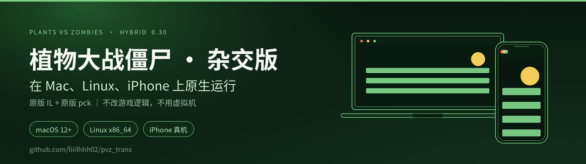
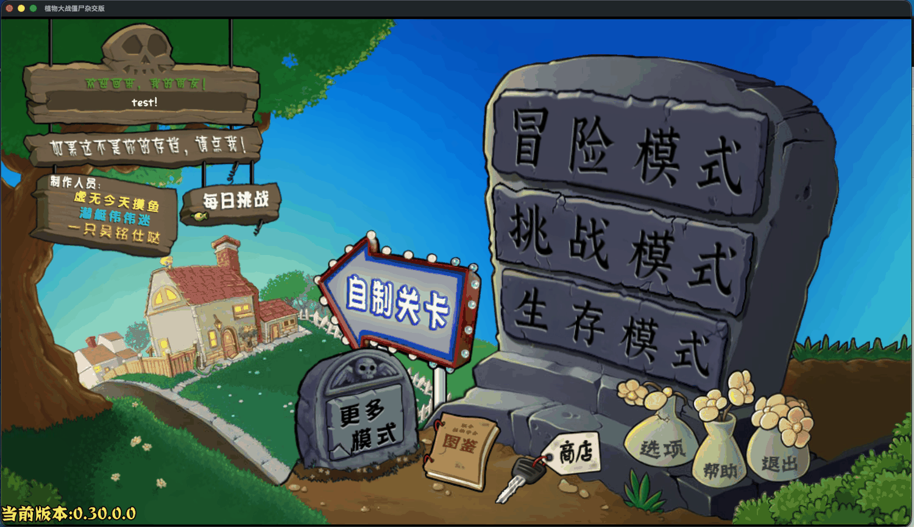

<div align="center">



# 植物大战僵尸杂交版 · 全平台移植

**在 Mac、Linux、iPhone 上原生运行《植物大战僵尸杂交版 0.30》**<br>
不用 CrossOver、Parallels、云游戏或串流：复用原版纯 IL 程序集和原版 pck，接上对应平台的 Godot 4.7 运行时。

[](https://github.com/liiilhhh02/pvz_trans/releases/latest)


<a href="https://github.com/liiilhhh02/pvz_trans/stargazers"></a>

[下载](#下载) · [平台状态](#平台状态) · [实机截图](#实机截图) · [原理](#为什么能跑) · [常见问题](#常见问题) · [技术笔记](mac/MIGRATION_NOTES.md)

</div>

## 这是什么

杂交版只有 Windows 版。这个仓库把它搬到三个原本玩不到的平台上：

- **macOS**：免安装 DMG，Intel 与 Apple Silicon 通用，双击即玩
- **Linux**：x86_64 免安装目录，自带 .NET 运行时，不依赖系统 dotnet
- **iPhone**：NativeAOT 编译成真机原生代码，用你自己的 Apple ID 签名安装

做法不是反编译重写，也不是虚拟机：原版 `PlantsVsZombies.dll` 是纯托管 IL，游戏数据 `pck` 未加密且不含原生插件。两者都不用改，只需要换掉平台绑定的那一层引擎。

## 下载

预编译包在 [Releases](https://github.com/liiilhhh02/pvz_trans/releases/latest)。

| 平台 | 文件 | 大小 | 说明 |
|---|---|---|---|
| **macOS 12+**<br>Intel / Apple Silicon | [`PvzHybrid-macOS-universal-v0.30.dmg`](https://github.com/liiilhhh02/pvz_trans/releases/latest/download/PvzHybrid-macOS-universal-v0.30.dmg) | 452 MB | 挂载后拖进「应用程序」。ad-hoc 签名、未公证，首次打开需右键 → 打开 |
| **Linux x86_64** | [`PvzHybrid-linux-x86_64-v0.30.zip`](https://github.com/liiilhhh02/pvz_trans/releases/latest/download/PvzHybrid-linux-x86_64-v0.30.zip) | 374 MB | 解压后 `./PvzHybrid.x86_64`；可执行文件、pck、`data_*` 目录必须放在一起 |
| **iPhone** | 无预编译包 | — | 免费 Apple ID 的证书 7 天过期，必须用自己的账号重签，见 [iOS 安装](#ios-真机安装) |

> [!NOTE]
> Windows 和 Android 直接用官方原版包即可，本仓库对这两个平台没有任何修改。

## 平台状态

| 平台 | 状态 | 验证到什么程度 |
|---|---|---|
| macOS 12+（Universal） | **已实测** | 0.26.1 / 0.28.1 / 0.29 / 0.30 四个版本打包通过；0.30 连续 8 次冷启动 8/8、断网启动、挂机 600 秒均正常；DMG 从只读卷直接运行通过 |
| Linux x86_64（glibc ≥ 2.31） | **构建已验证** | 产物为 ELF x86-64，程序集 md5 与原版一致，pck 已替换为原版；作者手上没有 Linux 主机，**尚未实机启动**，欢迎反馈 |
| iPhone 真机（iOS 16+） | **已实测** | 2026-10-18 在 iPhone 17 Pro Max 上：NativeAOT 发布、xcodebuild、`devicectl` 安装与启动全部通过 |
| iOS 模拟器 | 不支持 | 模拟器 Metal 不支持 image cube arrays，Godot Metal 渲染器起不来 |
| Windows / Android | 原版即可 | 本仓库未修改 |

已知问题也写在这里，避免误判：

- macOS 上偶发启动崩溃（`.ips` 显示 SIGBUS 在 .NET 终结器线程回调引擎原生码），调试期 10 次左右出现 1 次，随后 10 轮连续测试未复现；无游戏源码，无法根除。
- iOS 上游戏内的模组编辑器不可用：它依赖 Roslyn 运行时编译，NativeAOT 不支持动态代码生成。基础游戏不受影响。
- 所有包都未做 Apple 公证，跨机分发只能右键打开。

## 实机截图

<div align="center">



<sub>macOS 0.30 实机运行：系统原生窗口，直接加载原版 pck，没有 CrossOver、虚拟机或串流</sub>

</div>

## 为什么能跑

1. **程序集是纯 IL。** `PlantsVsZombies.dll` 的 `IlOnly=true`、`ImplMap=0`，AssemblyRef 里没有任何 Windows 专有程序集；Windows 版与 Android 版逐字节只差 21 字节（PE machine、时间戳、MVID）。游戏逻辑里没有平台分支。
2. **pck 是跨平台的。** 未加密，没有 `.dll`/`.so`/`.gdextension`，场景、贴图、字体与配置都能被任意平台的 Godot 4.7 读取。pck 只做载入，字节不动。
3. **每个平台只换运行时。** 桌面允许 JIT，CoreCLR 直接跑原版 IL；iOS 禁止 JIT，用 NativeAOT 交叉编译成 `ios-arm64`。
4. **macOS 上唯一必修的补丁是 2 个字节。** 原版程序集的 PE machine 是 `0x8664`/`0xaa64`，macOS 的 CoreCLR 会以 `0x80132006` 拒绝绑定；改成 AnyCPU（`0x14C`）即可，IL 语义完全不变。

完整的证据链、数据目录配方、日志判读表和排错速查在 [`mac/MIGRATION_NOTES.md`](mac/MIGRATION_NOTES.md)。

## 快速开始

### macOS

1. 下载 DMG，双击挂载，把 App 拖进「应用程序」。
2. 首次打开：右键 → 打开（或 `xattr -dr com.apple.quarantine "/Applications/植物大战僵尸杂交版.app"`）。

要求 macOS 12+。不要用 Windows 工具重新打包，会丢符号链接和权限，表现为「已损坏」。

<details>
<summary><b>从源包重新打包（换版本 / 自定义）</b></summary>

需要 Windows 导出 zip + Android APK（或只用 zip），脚本会自动下载引擎模板和 .NET 运行时：

```bash
cd mac
python3 port_pvz_mac.py --zip 0.30.zip --apk 0.30.APK --dmg --dmg-format ULMO
```

`--inspect` 只体检不出包，`--offline` 复用缓存，`--universal` 产出 Intel + Apple Silicon 通用包。
</details>

### Linux

用发布包：

```bash
unzip PvzHybrid-linux-x86_64-v0.30.zip -d pvz
cd pvz && ./PvzHybrid.x86_64
```

从源码构建：

```bash
cd linux
./build_linux.sh          # 需要 Godot 4.7.2 mono；缺少 Linux 导出模板会自动安装
```

> [!IMPORTANT]
> `build_linux.sh` 和 `deploy_ios.sh` 都需要一份 **Godot 重建工程**（`project.godot`、`PlantsVsZombies.csproj`、`.sln`、导出预设）。这份工程不在本仓库里，因为 pck 中的 `.cs` 是空占位、没有源码。脚本用 `PVZ_REBUILD` 指向工程根目录（默认 `~/Downloads/pvz-rebuild`）。只想要成品的话，用发布包即可。

### iOS 真机安装

前置：macOS + Xcode（已登录 Apple ID）+ Godot 4.7.2 mono + .NET SDK 9 + 一份重建工程。

```bash
cd ios
./deploy_ios.sh            # 首次完整构建，2-3 分钟
./deploy_ios.sh --renew    # 免费证书 7 天过期后续签，约 30 秒
```

首次安装后到「设置 → 通用 → VPN与设备管理」信任证书。续签请保持设备连接并解锁，不要先删 App，覆盖安装会保留存档。

细节、签名排错与证书限制见 [`ios/README.md`](ios/README.md)。

## 需要自备的文件

仓库不附带游戏资源。从原版 Windows 发布包中取：

```
植物大战僵尸杂交版发布版0.30.0.Csharp.pck          # 约 479 MB，用 ORIG_PCK 指定
data_PlantsVsZombies_windows_x86_64/PlantsVsZombies.dll
```

DLL 放到 `ios/assets/` 和 `linux/assets/`（两处可以是同一个文件）。

**pck 必须是原版那份。** 自己从工程导出的 pck 只有 61 MB 左右，缺素材，进游戏会黑屏。

## 常见问题

<details>
<summary><b>macOS 提示「已损坏，无法打开」/「无法验证开发者」</b></summary>

包是 ad-hoc 签名、未公证。右键 → 打开，或执行 `xattr -dr com.apple.quarantine <App>`；不要点「移到废纸篓」。
</details>

<details>
<summary><b>进游戏黑屏、没声音、缺素材</b></summary>

99% 是 pck 不对：确认用的是原版约 479 MB 的 pck，且已替换进包内（macOS 是 `Contents/Resources/<exe>.pck`）。
</details>

<details>
<summary><b>需要安装 Godot、.NET 或 CrossOver 吗</b></summary>

玩游戏不需要，发布包自带引擎和 .NET 运行时。只有自己构建时才需要 Godot 4.7.2 mono 与 .NET SDK 9。
</details>

<details>
<summary><b>免费 Apple ID 的 7 天限制</b></summary>

开发证书和描述文件都是 7 天有效，到期后图标还在但打不开。执行 `./deploy_ios.sh --renew` 重签即可。免费账号同时最多 3 个自签 App、每周最多 10 个 App ID。
</details>

<details>
<summary><b>升级到新版本（如 0.31）</b></summary>

macOS：换 zip/APK 重跑 `port_pvz_mac.py`。iOS / Linux：替换 pck 与 DLL 后重新构建。四个已测版本的引擎、.NET、目录结构完全一致，脚本通用。
</details>

<details>
<summary><b>会不会影响原版、会不会封号</b></summary>

本仓库不改游戏逻辑、不注入进程，只是换运行时。是否联网、是否登录由游戏本身决定；断网启动实测可进入游戏。
</details>

## 目录

| 路径 | 内容 |
|---|---|
| [`mac/`](mac/) | 一键打包 `.app` / DMG、稳定性自测、包体检工具，以及 300 行迁移笔记 |
| [`ios/`](ios/) | 真机安装与重签脚本、原版 IL 的 MSBuild target、日志抓取 |
| [`linux/`](linux/) | Linux x86_64 构建脚本 |
| [`docs/`](docs/) | 仓库头图、社交预览图与实机截图 |

脚本未声明开源许可证（默认保留所有权利）。要复用或分发脚本，请先开 Issue 联系作者。

## 致谢与免责

- 《植物大战僵尸》的名称、美术、音频等权利归 EA / PopCap 所有；杂交版的代码与内容归其作者所有。
- 本仓库只包含迁移脚本与文档，不包含游戏源码、素材、程序集或 pck。发布页中的整合包内含原版资源，仅用于个人迁移研究，请勿再分发或商用。
- 使用前请确认你已合法持有原版软件。编译、安装、分发的行为及其后果由使用者自行承担。

## English

Run *Plants vs. Zombies Hybrid* 0.30 natively on macOS (Universal), Linux x86_64, and iPhone. The game's managed assembly is pure IL with no P/Invoke, and its `.pck` is unencrypted, so this project reuses both and only swaps the platform-specific Godot runtime — no decompilation, no virtualization, no streaming. Grab the macOS DMG or Linux build from Releases; iOS requires re-signing with your own Apple ID via NativeAOT. Build scripts and the full write-up live in `mac/`, `linux/`, and `ios/`.
